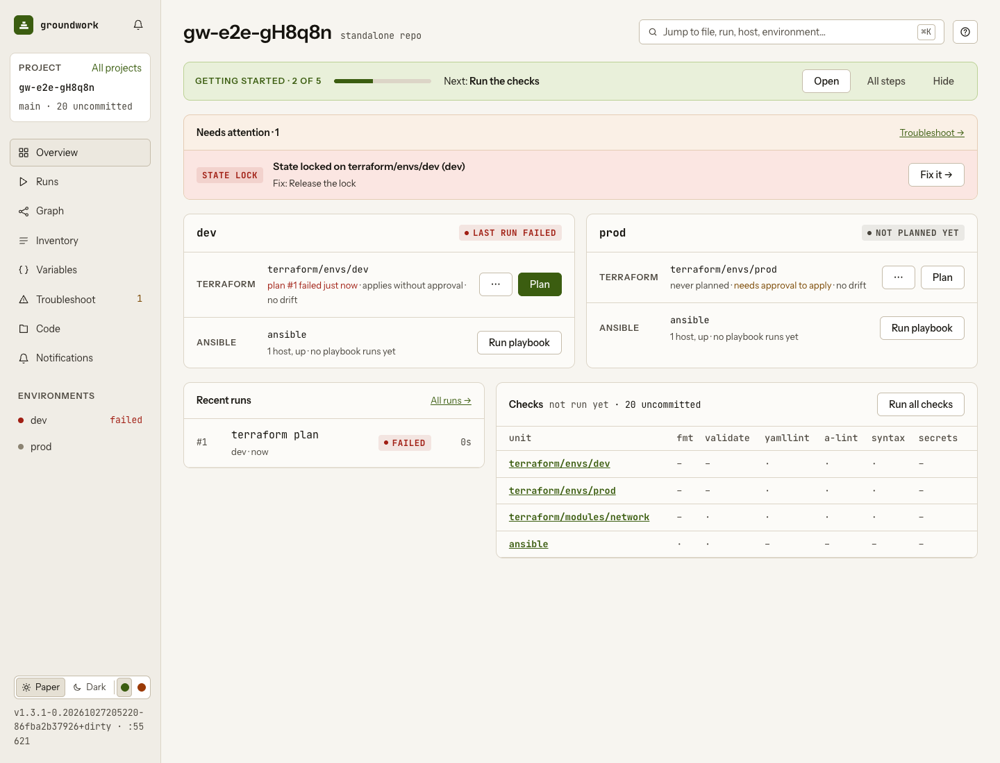
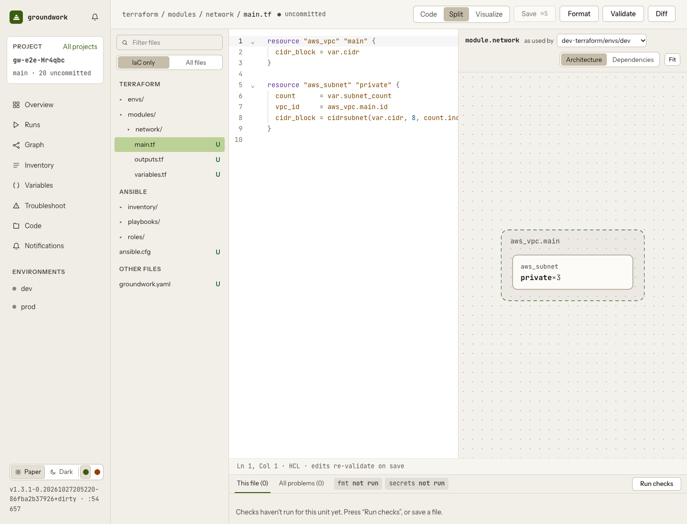
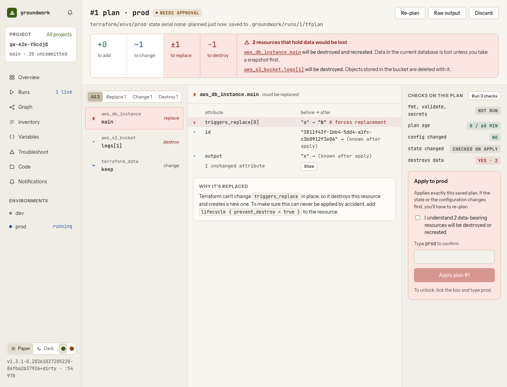
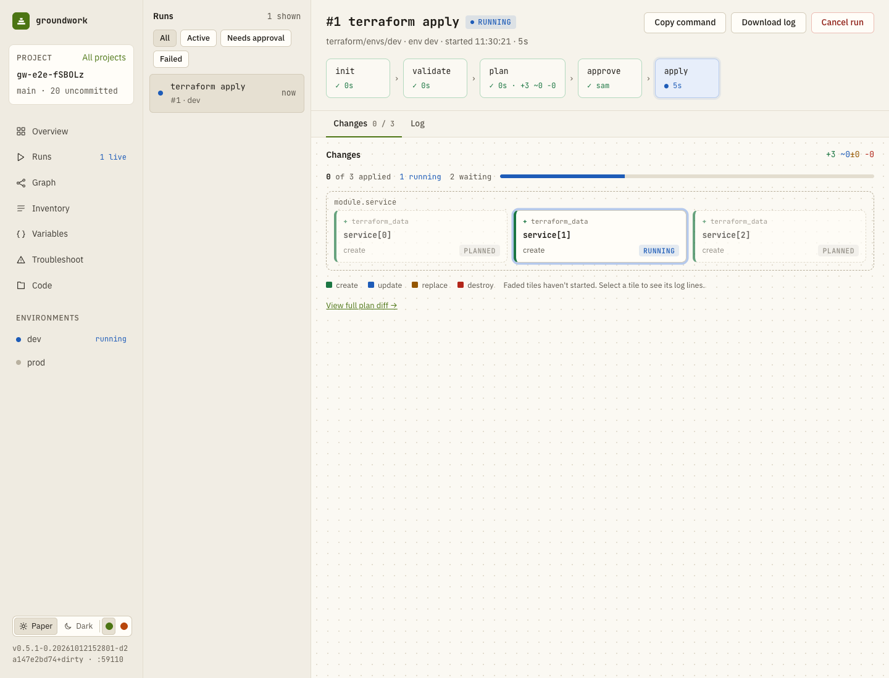
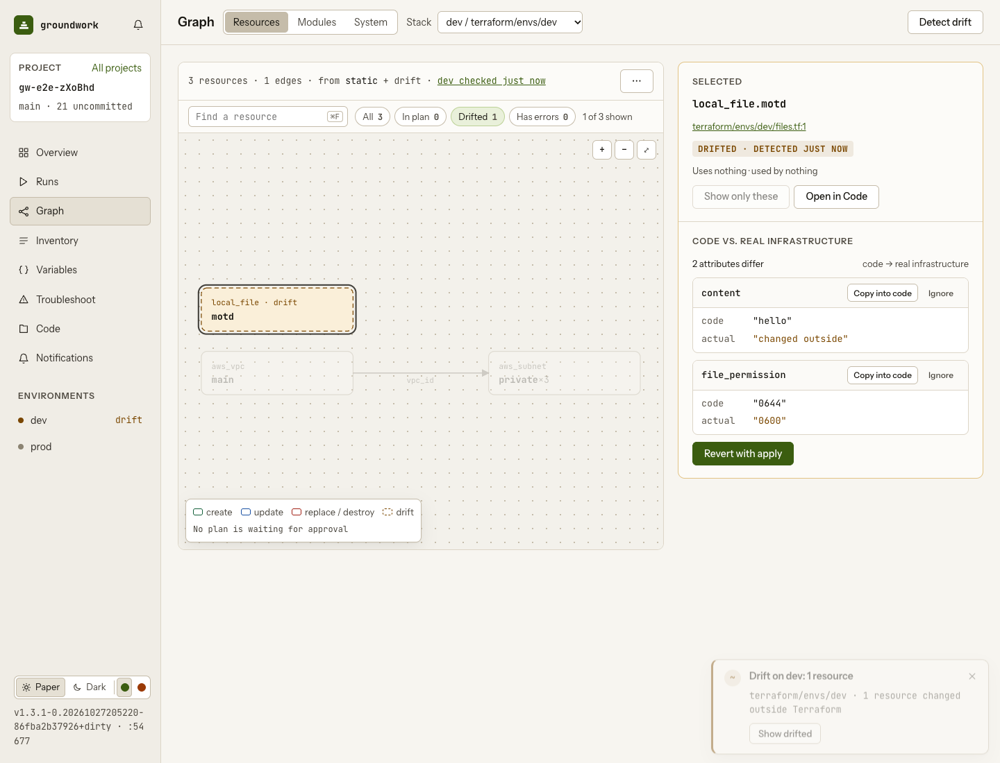
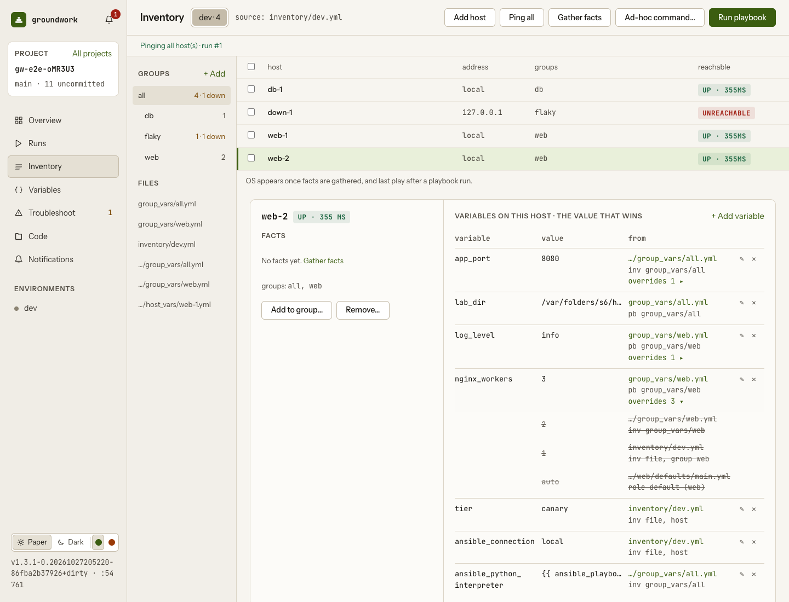
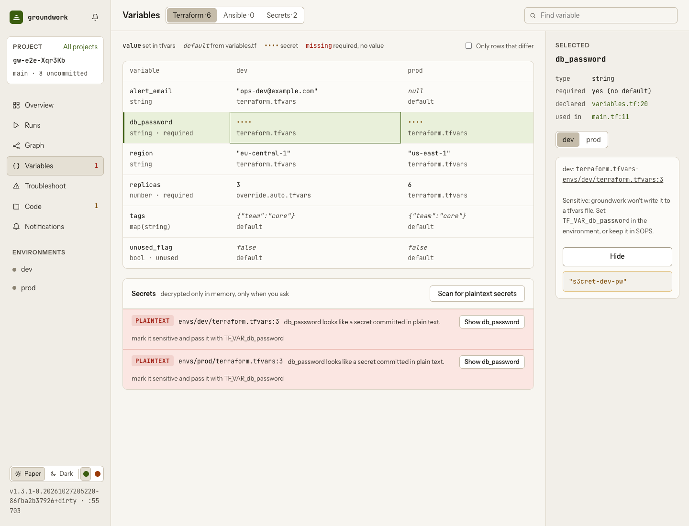
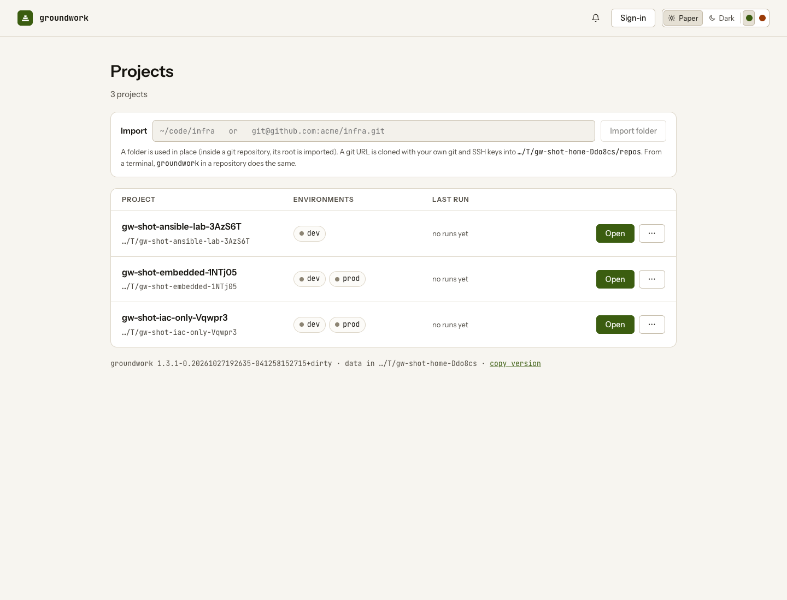
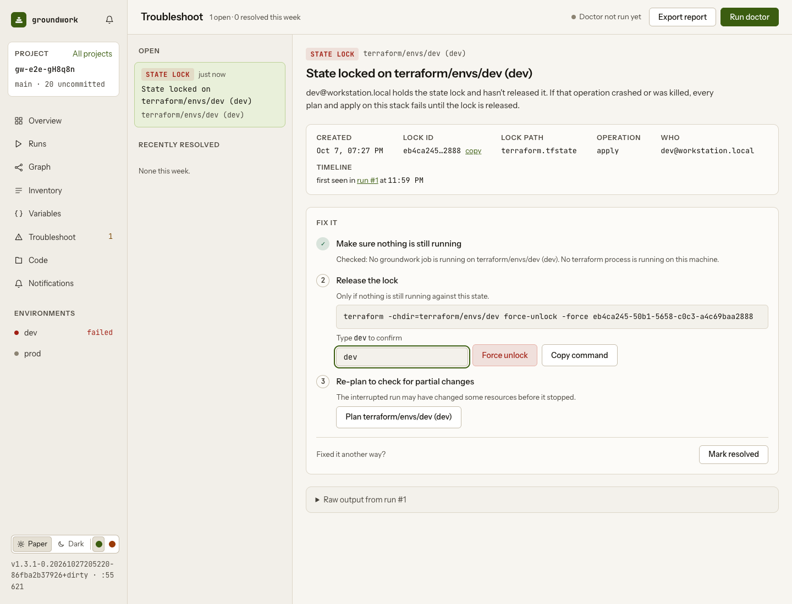

<p align="center">
  <picture>
    <source media="(prefers-color-scheme: dark)" srcset="docs/images/logo-dark.svg">
    
  </picture>
</p>

<h1 align="center">groundwork</h1>

A local web console for Terraform and Ansible. It runs as a background service on your machine and hosts all your infrastructure repositories as projects. For each one it detects your infrastructure code, checks it as you edit, runs plans, applies and playbooks with live logs, and explains failures with a fix. One binary, no accounts, nothing leaves your machine except through the tools you already use.

```sh
curl -fsSL https://raw.githubusercontent.com/rapando/groundwork/main/install.sh | sh
cd your-infra-repo
groundwork
```

`groundwork` starts the service if it isn't running, imports the repository you're in as a project and opens it at `http://localhost:7420`. On the first visit you choose how to sign in: Touch ID (or another passkey), a password, or both. Run it in other repositories to add them, or import a folder or a git URL from the console's project list. `groundwork service install` starts the service at login.



## What it does

- **One service, many projects**: every repository you import gets its own checks, runs, file watching and drift schedule, behind one console. Import a folder in place, or a git URL that groundwork clones with your own git and SSH keys ([service and projects](docs/service.md)).
- **Detects** Terraform roots, modules and Ansible projects, in a dedicated infrastructure repo or in an application repo that keeps them in a subfolder, and writes a `groundwork.yaml` you can review. An empty repo gets only what the tools you choose need (Terraform or OpenTofu, Ansible, or both): groundwork's config, and with both, an inventory script that turns your Terraform hosts into Ansible hosts. You write the Terraform and the playbooks. With Ansible, setup asks for the ansible-vault password, kept in memory or in a password file it creates ([setup](docs/setup.md)).
- **Checks on every save**: `fmt`, `validate`, tflint, checkov, yamllint, ansible-lint, playbook syntax and a plaintext-secret scan, with problems inline in the editor ([checks](docs/checks.md)).
- **Plans, then applies only what you approved**: plan review with masked sensitive values and danger flags, typed confirmation for production, and the exact saved plan applied. A plan that went stale (code, state or time) can't be applied. **Destroy…** tears an environment down the same way: a reviewed `plan -destroy`, approved by typing the environment's name ([runs](docs/runs.md#destroy)).
- **Ansible**: inventory with reachability and facts, variable provenance per host, dry run → approve → run, ad-hoc commands ([ansible](docs/ansible.md)).
- **Graph and drift**: resource dependency graph, an architecture view that follows unsaved edits, refresh-only drift detection with copy / ignore / revert, optionally on a schedule with [notifications](docs/notifications.md) ([graph](docs/graph.md)).
- **Variables and secrets**: per-environment variable matrix with sources, SOPS and ansible-vault values revealed on request, ansible-vault values and files created, edited and rekeyed without plaintext touching the disk, the vault password read from a file or typed in the console and kept in memory only, plaintext secrets moved into the vault ([variables](docs/variables.md)). See [Ansible vault](#ansible-vault) below.
- **Notifications**: hear about failed runs (with the matched cause), plans waiting for approval, long runs that finished and drift, in the console, on the desktop or through a Slack-compatible webhook, per event and environment, with a per-run override ([notifications](docs/notifications.md)).
- **Troubleshooting**: failures matched to known causes (stale state locks, expired credentials, unreachable hosts, …) with guided fixes, and a Doctor for your tools, cloud credentials, the Docker daemon, SSH agent and S3 state backends ([troubleshooting](docs/troubleshooting.md)).

| | |
|---|---|
|  |  |
|  |  |
|  |  |
|  |  |

The console comes in two themes, **Paper** (the default) and **Dark**, switchable from the sidebar or ⌘K; the code editor and graph follow the theme.

## Install

macOS and Linux (amd64, arm64).

```sh
curl -fsSL https://raw.githubusercontent.com/rapando/groundwork/main/install.sh | sh
# or, from source (Go 1.27.3+)
go install github.com/rapando/groundwork/v2/cmd/groundwork@latest
```

The script verifies the download against the release checksums (and their cosign signature, when cosign is installed) and installs to `~/.local/bin` without `sudo`. Then, optionally, start the service at login:

```sh
groundwork service install   # launchd on macOS, systemd --user on Linux
groundwork service status
```

Run `install` from a shell where `terraform` and `ansible` work: the login service keeps that shell's `PATH`. groundwork uses the `terraform` (or `tofu`) and `ansible` it finds there, plus any linters you have; `groundwork doctor` shows what it found. Supported floors: terraform ≥ 1.4 or tofu ≥ 1.6, and ansible-core ≥ 2.14; Doctor warns below them.

**Upgrading:** run the install script again, then `groundwork service restart`. The CLI warns while the service still runs the old version; project data is backed up, then migrated when each project is next opened. Coming from 0.1, where groundwork ran one server per repository in your terminal, see [upgrading to 0.2](docs/install.md#from-01-to-02).

See [install](docs/install.md) for manual downloads, checksums, the install script's options and removal.

## Commands

| | |
|---|---|
| `groundwork` | import this repository into the service (starting it if needed) and open it (`--no-open`, `--port`; `--foreground` serves in this terminal instead) |
| `groundwork add <folder \| git URL>…` | import projects; a URL is cloned into the service's data directory |
| `groundwork projects` · `open [project]` · `remove <project>` | list with status, open in the browser, stop managing (files stay) |
| `groundwork service install \| uninstall \| start \| stop \| restart \| status \| logs` | run at login, or control the background service and read its log |
| `groundwork serve [folder…]` | run the service in the foreground (what the login service runs) |
| `groundwork init [--tools terraform,ansible] [--detect] [--dry-run] [--yes]` | write `groundwork.yaml`, or set up an empty repo, without the UI |
| `groundwork check [--json] [--unit <id>] [--fail-on error\|warning]` | run all checks once; non-zero exit on problems (for CI) |
| `groundwork doctor [--json]` | tools, credentials, Docker daemon, S3 backends and locking, SSH agent, inventory reachability, disk |
| `groundwork drift [--env prod]` | refresh-only drift check of every environment |
| `groundwork auth status \| reset` | show the console's sign-in methods, or remove them if you are locked out |
| `groundwork version` | |

## Ansible vault

groundwork manages ansible-vault secrets on the project's **Variables → Secrets** tab. Plaintext never touches the disk, and every time someone opens a value it's recorded in an audit list.

**1. Give groundwork the vault password**, in one of two ways:

- **Type it in the console** (setup's default; setup asks for it and unlocks the vault). With no password file configured, the Secrets tab shows **Vault locked**. Click **Unlock…** and type the password. groundwork checks it against an encrypted value, then keeps it in the service's memory until you click **Lock** or the service stops. Ansible reads it from a pipe, never from a file, an argument or an environment variable.
- **Or use a password file**, set on the project in `groundwork.yaml`:

  ```yaml
  ansible:
    projects:
      - path: ansible
        vault_password_file: ~/.vault-pass   # a plain file; scripts are refused unless allow_vault_script: true
  ```

  When setting up, choose **Password file** under *ansible-vault password*, or pass `groundwork init --vault-password-file ~/.vault-pass`: groundwork creates the file with the password you type, unless it already exists. `ANSIBLE_VAULT_PASSWORD_FILE`, and `vault_password_file` or `vault_identity_list` in `ansible.cfg`, work too. A `label@prompt` vault ID is typed in the console like the default one. `groundwork doctor` checks the file.

**2. Manage secrets on Variables → Secrets:**

- **New secret** adds an encrypted variable (`name: !vault |`) to a vars file, creates an encrypted file, or encrypts an existing file in place.
- **Edit** decrypts a value into an editor and saves it re-encrypted. Opening it counts as a reveal and is recorded.
- **Move to vault** appears on a plaintext-secret finding from the built-in scanner. It encrypts that value in place. The old value is still in git history, so rotate it.
- **Rekey…** re-encrypts every value of a vault ID with a new password. Everyone who uses the vault needs the new password.

**3. Use the secrets in your playbooks** as usual, e.g. `{{ db_password }}`. Dry runs, playbook runs, ad-hoc commands and the inventory all open the vault with the password file or the password you typed. A run that needs a locked vault fails with a fix that links to **Unlock**.

Don't run `ansible-vault decrypt` on files in the repository: it leaves the secret unencrypted in your working tree. For Terraform secrets, ansible-vault isn't the tool. Instead:

1. Mark the variable `sensitive = true`.
2. Remove the value from the tfvars file.
3. Pass it as `TF_VAR_<name>` in the service's environment.

See [variables](docs/variables.md#managing-ansible-vault) for the details.

## Safety

- The server listens on `127.0.0.1` only, and the console asks for your password or passkey; other websites can't reach it (Host and Origin checks, strict CSP). Locked out? `groundwork auth reset`. See [security](docs/security.md).
- Nothing changes infrastructure without a plan you reviewed and approved. Production-like environments need their name typed.
- Each project's state (runs, plans, history) lives in its own `.groundwork/` (git-ignored). The only file groundwork adds to your repo is `groundwork.yaml`.
- The service keeps its project list, sign-in settings, CLI token, log and cloned repositories in `~/Library/Application Support/groundwork` (macOS) or `~/.config/groundwork` (Linux); set `GROUNDWORK_HOME` to move it.
- What stays stable across releases (`groundwork.yaml`, the CLI, how data is migrated and backed up) is written down in [compatibility](docs/compatibility.md); the HTTP API is private to the bundled UI.

## With coding agents

[`skills/groundwork`](skills/groundwork/SKILL.md) is an agent skill for Claude Code and other skill-aware agents. It teaches them to validate changes with `groundwork check --json`, diagnose with `doctor`, check drift and scaffold repositories, and to hand plans and applies to you in the console rather than applying anything themselves. See [agents](docs/agents.md) to install it.

## Try it

[`examples/docker-env`](examples/docker-env) builds three servers as Docker containers with Terraform, then Ansible installs RabbitMQ, Redis and nginx on them. It needs Docker, Terraform and Ansible, and no cloud account:

```sh
cp -R examples/docker-env /tmp/docker-env && git -C /tmp/docker-env init -q
cd /tmp/docker-env && groundwork            # opens it in the console: plan dev, approve, then run the playbook
```

## Development

```sh
make build   # SPA (web/) + binary (bin/groundwork)
make test    # Go + web unit tests
make e2e     # browser tests (installed Chrome)
make integration  # with real terraform/ansible/linters on PATH
make perf    # 5,000-file repository timings
make fuzz    # each fuzz target for 30s
```

The UI is Vue 3 + TypeScript in `web/`, built into `internal/server/dist` and embedded in the binary. [docs/architecture.md](docs/architecture.md) describes how the pieces fit. See [CONTRIBUTING.md](CONTRIBUTING.md) for how changes land and [SECURITY.md](SECURITY.md) for reporting vulnerabilities.
