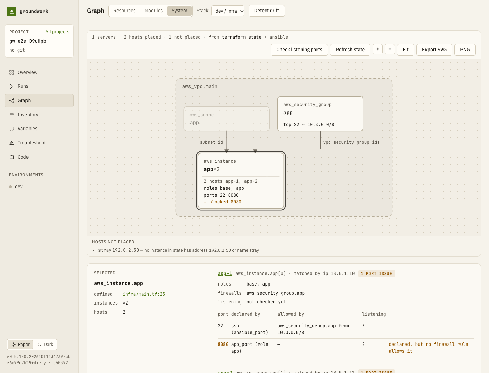

# Graph, Visualize and drift

## Dependency graph (Graph screen)

Pick a stack (root + environment). Resources are nodes; an arrow points from a dependency to what uses it, labelled with the argument that holds the reference. `count`/`for_each` instances collapse into one node with ×N, where N is resolved from the environment's tfvars and module arguments when possible (×n otherwise).

The model comes from **static analysis of the HCL**: it needs no `terraform init` and no credentials. References are followed through module variables and outputs, so an edge from a root resource into a module's resource is exact. When the root has been initialised, edges from `terraform graph` are merged in. Overlays: the newest plan waiting for approval (create / update / replace / destroy) and recorded drift (dashed amber). The legend card in the canvas's bottom-left corner names the overlaid plan, its status and age, with a link to review it. **Modules** collapses the graph to one node per module. Zoom in, out and fit with the buttons in the canvas's top-right corner (the same in every Graph view); export as SVG or PNG from the **⋯** menu.

**Selecting a resource** lights up everything it uses and everything that uses it, directly or not, along the edges between them; the rest fades, and its direct neighbours are labelled *uses* and *used by*. The inspector (beside the canvas on wide screens, below it on narrow ones) lists both with counts and warns when something downstream is replaced or destroyed in the overlaid plan. *Show only these* redraws the graph with just that resource and what it reaches; *Open in Code* opens its definition. Escape clears the selection.

**Finding a resource.** *Find a resource* (⌘F / Ctrl+F on the Graph page) matches the address, type, name or file; Enter selects the first match and centres the canvas on it (Enter again moves to the next). The chips filter to **All**, **In plan**, **Drifted** or **Has errors**, with counts. Nothing moves: matches stay as they are, their neighbours fade and the rest almost disappear. The filter is in the URL (`?filter=plan|drifted|errors`), so a link such as the drift notification's *Show drifted* opens the graph filtered.

## System (Graph screen → System)

The Ansible hosts of the same environment, drawn as boxes with the services running on them and the ports each service uses. Each service is a card: a status dot (green: its ports are declared, allowed and listening; amber: one is blocked or not listening; grey: not checked yet), its ports as chips coloured the same way, and where it came from (`role nginx · site.yml`) or, when something is wrong, what (`no firewall rule for 8080`, `nothing listens on 8080`). A process the ports check found listening that no role declares gets a dashed card. Roles without ports share one *also:* line, and ssh sits in the host's header with the OS when known (`debian 12 · ssh 22`). Hosts sit inside a dotted frame per inventory group, named above it; nested groups show their parents as a path (`prod / web`), and `all` is not drawn. A host listed in two or more groups is drawn in each and marked with `*`; selecting one highlights its copies. Hosts in no group go in an *ungrouped* frame. Each box names the Terraform server the host was matched to, or says *not placed*. The Terraform network (VPCs, subnets, firewalls) is in the Resources view. A stack pairs with every Ansible inventory whose environment has the same name (`dev` ↔ `inventories: {dev: …}`); a project without `inventories:` has one inventory for all environments and pairs with every stack.

The summary line counts hosts, groups, services and port issues, and says how old the pulled state is and when ports were last checked. *Check listening ports* is next to it; *Refresh state* and the exports are in the **⋯** menu.

**Placing hosts.** groundwork runs `terraform state pull` (read-only, 30 s timeout, reused for a minute; *Refresh state* pulls again) and matches each host's address (`ansible_host`, else its name) against the IP addresses in state, then against machine names (`name`, `tags.Name`, `hostname`, …). A match on something that isn't a server (an elastic IP, a network interface) moves to the server that references it; server types are listed in `internal/graph/rules.yaml`. Hosts that match nothing, or several servers, are drawn as *not placed*; the inspector gives the reason. The state is reduced to addresses and firewall rules as it is read and never stored or logged. The root must be initialised; without state every host is drawn as not placed.

**Services** are the roles of every play whose `hosts:` pattern takes in the host (groups, globs, `~regex`, `&` and `!` are resolved as Ansible does; templated patterns are skipped), including `include_role`/`import_role` tasks and role dependencies from `meta/main.yml`. Each role lists the ports its variables declare; a port declared outside a role is named after its variable (`redis_port` → redis), and processes found by *Check listening ports* are listed with their ports too. Ports open in a firewall that nothing uses are listed as *open*. A port is amber when it is **blocked** or **not listening** (below).

**Ports** come from three places, lined up per host in the inspector:

| Column | Source |
|---|---|
| declared by | `*_port` / `*_ports` variables: role defaults, then the inventory's values, then role vars; `"{{ other_var }}"` is followed, other templates aren't. `ansible_port` (default 22) shows as ssh unless the host uses a local/container connection. |
| allowed by | Inbound rules in state attached to the instance: AWS security groups (inline, `aws_security_group_rule`, `aws_vpc_security_group_ingress_rule`), `hcloud_firewall`, `google_compute_firewall` (by target tags), `digitalocean_firewall`, Vultr firewall groups (`vultr_firewall_rule`), and a `docker_container`'s published `ports`. Azure NSGs aren't read yet. |
| listening | *Check listening ports* runs `community.general.listen_ports_facts` on the environment's hosts: a read-only ad-hoc run that needs no approval. It works on Linux hosts that have `ss` (iproute2) or `netstat` (net-tools, busybox), and needs the `community.general` collection on the machine running groundwork; slim container images usually lack both tools, and the hosts it fails on are listed above the diagram with the reason. Only port, protocol, address and process name are kept; loopback listeners are left out. |

In the inspector, a host's *N port issues* chip jumps to the first flagged row; a blocked port says *no firewall rule allows it* under *allowed by*, and a port nobody has checked yet says *not checked · Check*, which runs the check.

Flags: **blocked** (declared, but no attached firewall allows it), **not listening** (declared, but the last check found nothing on it), and as notes, *undeclared* (listening and open but no variable mentions it) and *unused* (open, but nothing declares or listens on it). Wide ranges and rules open to every port are shown with the firewall's rules rather than as rows.

## Architecture (Code screen → Split / Visualize)

For `.tf` files the Code screen can show what the code builds: network resources (`aws_vpc`, `google_compute_network`, `azurerm_virtual_network`, `hcloud_network`, `digitalocean_vpc`, `docker_network`) are drawn as containers, and resources that reference them, directly or through a subnet-like argument (`vpc_id`, `subnet_id(s)`, `subnetwork`, `network_id`, …), sit inside. The rules are data (`internal/graph/rules.yaml`); resources that relate to nothing drawn are listed as "not placed" rather than guessed.

It is computed from the **unsaved editor buffer** (debounced 400 ms), so it follows your typing. The block under the cursor is outlined; clicking a box jumps to its definition; blocks with diagnostics get a red dashed border; resources outside the current file's module are dimmed. "As used by" picks which root/environment's values resolve counts. A file with syntax errors still shows what parses.

## Drift

**Detect drift** runs `terraform plan -refresh-only` as a read-only job (it takes the root's lock, needs no approval, and the refresh-only plan is deleted, never applied). You stay on the Graph: the button reads *Checking dev…* while a check of the root runs, the summary line says when the environment was last checked (linking to that run) and when the schedule runs next, and the graph redraws when the result is in. Drifted attributes are stored per root/environment (values masked like plan diffs) and shown in the Graph inspector as *in state/code* vs *actual*, on the Overview environment card, and in the sidebar.

Three actions per drifted attribute:

| Action | What happens |
|---|---|
| Copy into code | Sets the argument to the real value in the resource's block (top-level string/number/bool arguments only). |
| Ignore | Adds the attribute to `lifecycle { ignore_changes = [...] }`, creating the block if needed. |
| Revert with apply | Starts an ordinary plan; review and approve it as usual. |

Code edits go through `hclwrite` (comments and formatting are kept), are shown as a diff first, and are written only if the file hasn't changed since the preview. A resource deleted outside Terraform can only be reverted (the plan recreates it).

A drift schedule (`drift.schedule` in `groundwork.yaml`) checks every environment on a cron and notifies when drift changes; see [scheduled drift](troubleshooting.md#scheduled-drift) and [notifications](notifications.md).
